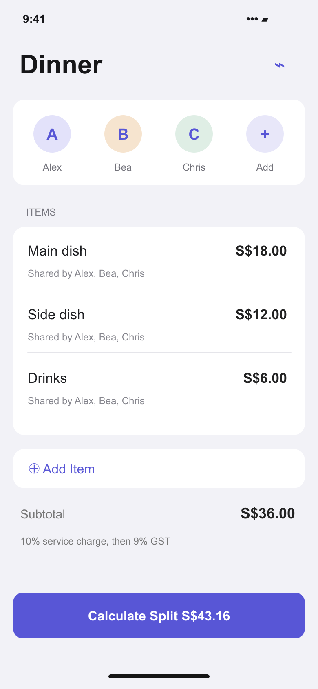
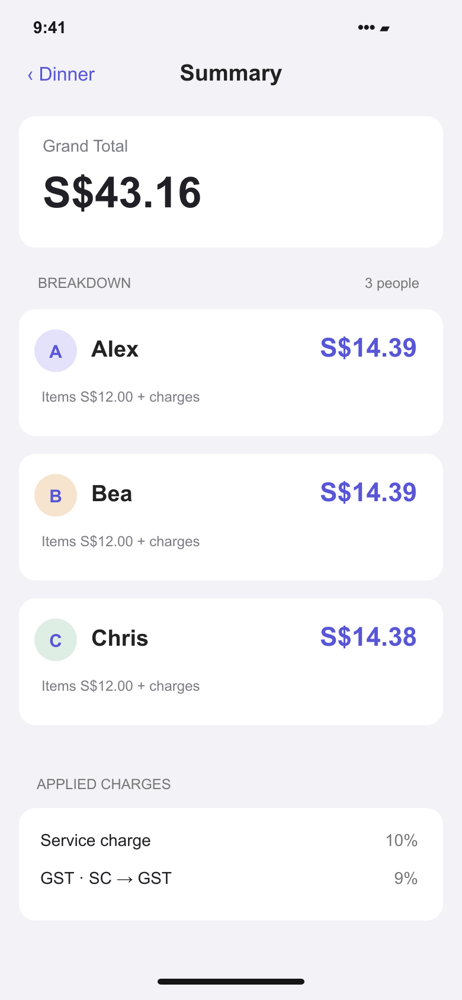

# Portfolio screens

Prepared for the Davin Cuaso portfolio on 6 November 2026.

These are source-based interface recreations with fictional sample data. They are not screenshots from a running native app or backend. Camera scenes and ingredient illustrations are schematic; measurements, saved places, and study statistics are sample content.

The SVG files are editable masters; PNG files are opaque exports.

## Receipt items and group

Source: [SplitSmart/Features/Bill/BillEntryView.swift](https://github.com/davincuaso/Bill-Splitter/blob/d1c99be5c6e6e7755944f5f07716038635992920/SplitSmart/Features/Bill/BillEntryView.swift).

## Per-person summary

Source: [SplitSmart/Features/Summary/SummaryView.swift](https://github.com/davincuaso/Bill-Splitter/blob/d1c99be5c6e6e7755944f5f07716038635992920/SplitSmart/Features/Summary/SummaryView.swift).

